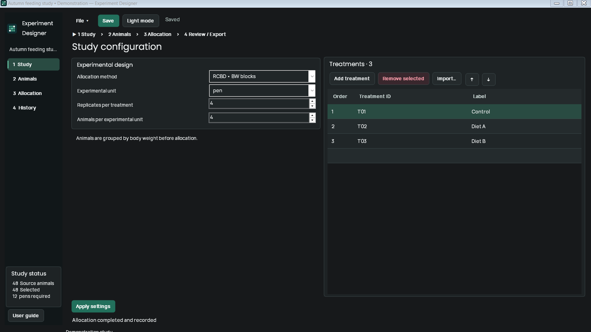

# Experiment Designer

## Download for Windows

**[Download Experiment Designer v1.1.2 for Windows (64-bit, 77 MB)](https://github.com/EhemAi/experiment-designer-app/releases/download/v1.1.2/Experiment-Designer-1.1.2-win-x64.zip)**

Ready to run. No GitHub account, coding tools, or separate .NET installation needed.

1. Download and extract the **entire ZIP**.
2. Open `Setup/ExperimentDesigner.Setup.exe` to install, or
   `App/ExperimentDesigner.exe` to run without installing.

[Installation details](#install-and-use) · [All releases and checksums](https://github.com/EhemAi/experiment-designer-app/releases)

Experiment Designer 1.1.2 is a Windows desktop application for reproducible animal
allocation in poultry, swine and other livestock trials. Researchers can prepare
pen or cage labels before animals arrive, import animal IDs and body weights,
generate seeded allocations, review baseline balance, and export Excel or print
reports. Prepared treatment locations stay fixed when animal allocation is repeated.



## Install and use

Download the Windows x64 ZIP and SHA-256 checksum from
[GitHub Releases](https://github.com/EhemAi/experiment-designer-app/releases).
Extract the complete ZIP before running or installing the app.

- Portable: open `App/ExperimentDesigner.exe`.
- Install/update for your Windows account: open `Setup/ExperimentDesigner.Setup.exe`.
- Keep App, Setup and Runtime together. No administrator access, Excel installation,
  SDK or separate .NET runtime is needed for the downloaded app.
- Windows Installed apps and Start contain the installed app. Save studies outside
  the installation folder; uninstall preserves unknown or modified user files.

The binaries are unsigned. Check the download source and SHA-256 checksum. See
[SECURITY.md](SECURITY.md) and the included offline [User guide](User%20guide.html).

Example: create three treatments with four replicates and four animals per pen.
Prepare housing 101–112 and print labels. Import at least 48 IDs/weights, generate
an allocation, inspect unit mean BW and export. The default pool favors the heaviest
required animals and records unused animals as EX. History retains earlier results.

RCBD, CRD and conventional allocation are supported. An initial-BW ANOVA p-value
at or below 0.6 recommends repeating with the next seed. This is a baseline balance
diagnostic, not proof of equivalent weights or experimental success. Review the
design and scientific suitability yourself. No sex-allocation feature is provided.
Numeric animal/treatment IDs and pen/replicate numbers sort numerically in Excel;
leading-zero, alphanumeric and over-15-digit identifiers retain exact text.

## Build from source

Prerequisites: Windows x64, PowerShell 7 and **.NET SDK 10.0.403** from
[Microsoft](https://dotnet.microsoft.com/download/dotnet/10.0).
Use the Windows x64 SDK, including the Windows Desktop runtime **10.0.14**.
`global.json` pins the SDK; `runtime-version.txt` pins the packaged security patch.
The scripts use `.tools/dotnet/dotnet.exe` when present, otherwise `dotnet` on PATH.
No private workbooks, credentials, Node.js or Python are required to build the app.

```powershell
git clone https://github.com/EhemAi/experiment-designer-app.git
cd experiment-designer-app
dotnet --version
./build-and-check.ps1
./check-source.ps1
./run-designer.ps1
```

The custom test executable fails on its first failed assertion. It covers seeded
allocation, independent mathematics, imports, persistence/replay, prepared housing,
ANOVA, Excel types, installer boundaries and synthetic native desktop workflows.
`./build-and-check.ps1 -SkipDesktop` runs core/controller checks alone. Native checks
need an interactive Windows desktop session; hosted GitHub runners run the core
suite and compile/analyze all desktop projects. Full native UI checks are run
locally before distribution. Printing depends on installed printer drivers.
Optional private workbook tests may report SKIP; the independent synthetic suite
does not need them. Logs and synthetic outputs go to ignored `analysis/`.

`./format-source.ps1` applies whitespace formatting. `./check-source.ps1` verifies
locked restores, compiler/security diagnostics and formatting. No third-party
runtime/test NuGet packages are used; the committed lockfiles record that graph.

To create a complete Windows distribution with checks:

```powershell
./build-package.ps1
```

The script uses the pinned runtime, verifies hashes, runs portable and installed
native workflows, checks the five-second launch, and writes a ZIP/checksum to
`dist/`. `dist/latest-package.txt` identifies it. Do not distribute an isolated EXE.

## Configuration and privacy

No API keys or network services are used. All application settings live locally.
An `.env.example` documents optional development settings; the app does not load
`.env` files. Set environment variables explicitly, for example:

```powershell
$env:EXPERIMENT_DESIGNER_THEME = 'dark' # or light; unset for saved/Windows default
./run-designer.ps1
```

`EXPERIMENT_DESIGNER_TEST_ANIMALS` optionally points to your private regression
workbook. Leave it unset for synthetic tests. Never commit data or local paths.
Projects save as `.experimentproj`; legacy `.poultryproj` files still open. Source
observations and history remain in saved projects, so treat them as research data.
Appearance is stored under your local application-data folder. Private inputs and
local developer tools are excluded from source and release archives.

## Cite

Emmanuel O. Alagbe. *Experiment Designer*, version 1.1.2 (2026).
Affiliations supplied by the author: Purdue University; The Ohio State University.
[ORCID: 0000-0002-0747-2866](https://orcid.org/0000-0002-0747-2866).
See [CITATION.cff](CITATION.cff) for machine-readable citation metadata.

[](https://doi.org/10.5281/zenodo.23698896)

[Version 1.1.2 DOI](https://doi.org/10.5281/zenodo.23698896) ·
[All versions (concept DOI)](https://doi.org/10.5281/zenodo.23698895).
The Zenodo record archives the released source; the Windows installer/portable ZIP
is available from [GitHub Releases](https://github.com/EhemAi/experiment-designer-app/releases/tag/v1.1.2).

## Contribute, security and license

Read [CONTRIBUTING.md](CONTRIBUTING.md), [CODE_OF_CONDUCT.md](CODE_OF_CONDUCT.md),
[SECURITY.md](SECURITY.md) and [CHANGELOG.md](CHANGELOG.md).
Report ordinary issues with synthetic reproductions through GitHub Issues.
Use the private security channel for vulnerabilities.

Copyright 2026 Emmanuel O. Alagbe. The original source is licensed under
[MIT](LICENSE); bundled fonts and runtime retain the licenses described in
[THIRD-PARTY-NOTICES.md](THIRD-PARTY-NOTICES.md). University affiliations do not
imply endorsement. Maintainer: [EhemAi](https://github.com/EhemAi).
